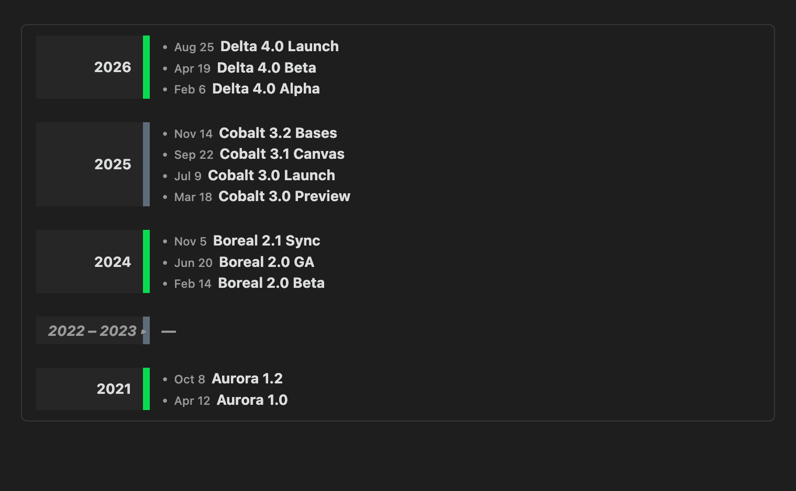
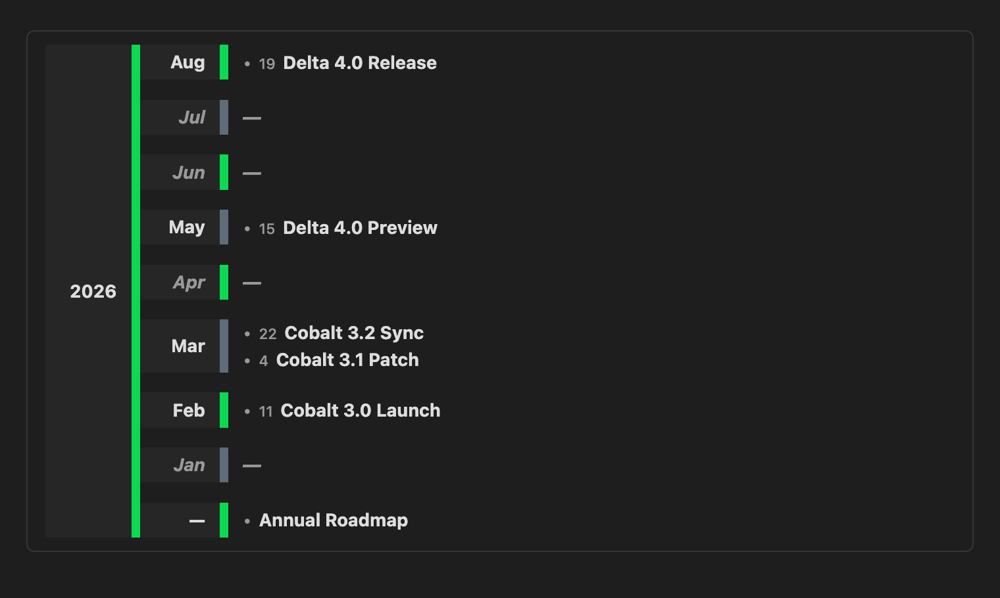
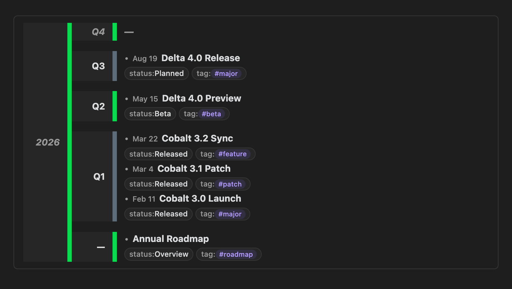
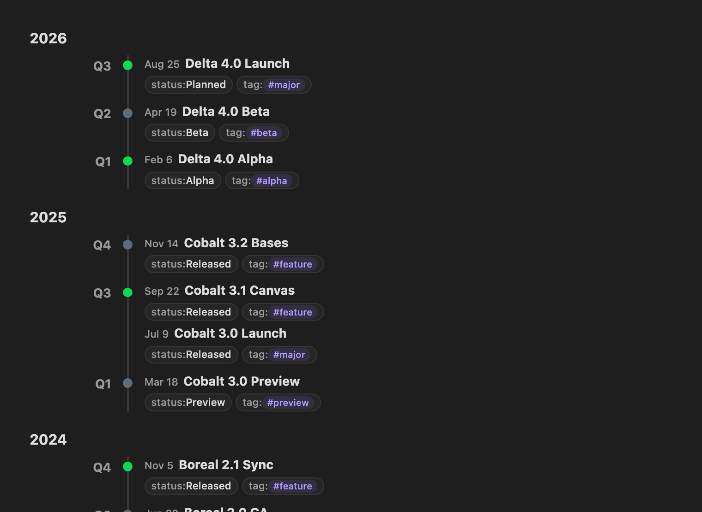
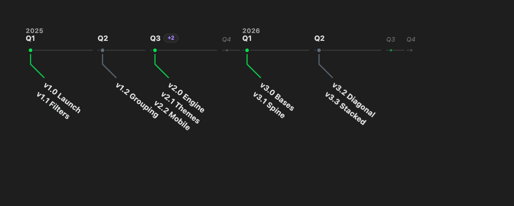
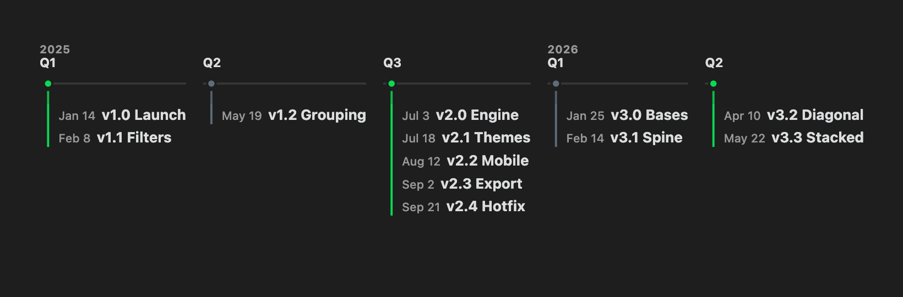

# Release Timeline Base View

This plugin renders release-style timelines as a custom [Obsidian Bases](https://help.obsidian.md/bases) view.

It does not depend on Dataview. Create a Base, filter the notes you want, and select the `Release Timeline View` custom view for that Base.

This project is based on the original release timeline plugin by cakechaser: https://github.com/cakechaser/obsidian-release-timeline. It has been adapted and expanded for native Obsidian Bases support.

## How to use

### 1. Store a date in note properties

Add a date property (or use `file.ctime` / `file.mtime`) to the notes that feed the Base. The plugin accepts:

- `2022` (year precision — shown in a year-level `—` bucket in Quarter/Month modes instead of misplaced in January)
- `2022-12` (month precision)
- `2022-12-31` (day precision, including ISO timestamps and epoch timestamps)

### 2. Create a Base and select the custom view

Example `.base` file:

```yaml
filters:
  and:
    - note.releaseDate
views:
  - type: release-timeline-base-view
    name: Release Timeline View
    mode: year
    timelineStyle: table
    dateProperty: note.releaseDate
    labelProperty: file.name
    sortDirection: desc
```

### View settings

- `mode`: `decade`, `year`, `quarter`, `month`, or `week`
- `timelineStyle`: `table` (classic wiki table), `spine` (vertical milestone spine), `horizontal` (condensed diagonal leaders), or `horizontalStacked` (horizontal axis with vertical item stacks)
- `dateProperty` / `labelProperty`: properties used for timeline dates and display titles
- `coverProperty`: optional image/cover property for thumbnail cards
- `colorProperty`: optional property used to color-code item bars and dots
- `sortDirection`: `asc` or `desc`
- `itemLayout`: `stacked`, `inline` (delimiter-separated), or `cards`
- `inlineDelimiter`: custom delimiter used when `itemLayout` is `inline`
- `bulletPoints`: show bullets in stacked layout
- `inlinePropertyStyle`: `stacked` list or compact `pills` for Base properties selected in the toolbar (renders clickable `[[wikilinks]]` and `#tags`)
- `showItemDates`: show per-item month/day badges next to note titles
- `showTodayMarker`: optionally highlight the current period (off by default)
- `showJumpBar`: show quick-jump year pills above multi-year timelines
- `fitHorizontalToWidth`: scale wide horizontal timelines smoothly to fit the available pane width
- `collapseEmptyYears` / `collapseLimit`: compress runs of empty years/decades into clickable, expandable range rows
- `collapseEmptyMonths` / `collapseEmptyWeeks`: hide or collapse empty periods in quarter, month, and week modes
- `weekDisplayFormat`: `weekNames` (`W15`), `dateNames` (`2025-08-19`), or `monthDayRange` (`Feb 13-20`)
- `accentAlternationMode`: `none`, `year`, `month`, or `both`
- `widthMode` / `widthPx`: auto-fit container width or fixed pixel width with responsive horizontal scroll
- Theme accent toggle or custom primary/alternate accent colors in plugin settings (updates open views live)

Note: note links follow Obsidian navigation conventions (click to open, Cmd/Ctrl-click or middle-click for a new tab, hover for preview, right-click for the file menu). Native Bases `groupBy` is also supported.

## Screenshots

### Classic table — Year view (with collapsed empty years & date badges)



### Classic table — Month view



### Classic table — Quarter view (with compact property pills & partial dates)



### Vertical spine layout



### Horizontal (diagonal) layout



### Horizontal (stacked) layout



## Quick compile and test

```bash
npm run verify
```

That command runs TypeScript type checking, ESLint (including Obsidian community plugin rules), a production build, and the core test suite.
